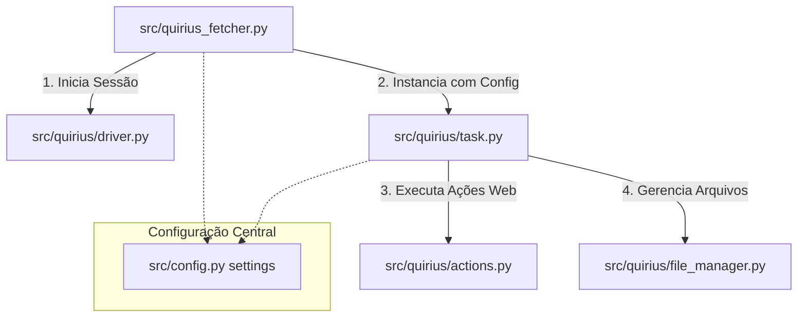

# Quirius Fetcher: Extrator de Relatórios RPA

Este documento descreve a arquitetura, organização do código e o fluxo de funcionamento do módulo **Quirius Fetcher**, uma automação baseada em Selenium projetada para extrair relatórios de mercadorias no Portal Quirius.

---

## 🏗️ Estrutura do Pacote (`src/quirius/`)

O módulo é estruturado com responsabilidades divididas em submódulos especializados:



### 1. [driver.py](../src/quirius/driver.py) (Gerenciamento do Browser)
* **`get_driver`**: Instancia e configura o Chrome WebDriver com preferências de download e flags de segurança (como o bypass para conexões HTTP locais).
* **`browser_session`**: Um gerenciador de contexto (`@contextmanager`) que gerencia a abertura e o fechamento automático da janela do navegador após o término da execução.

### 2. [actions.py](../src/quirius/actions.py) (Page Objects)
* **`QuiriusActions`**: Centraliza os seletores do DOM e interações de interface com a página (realizar login, selecionar empresa por ID, navegar entre menus, preencher campos de datas, executar a pesquisa e monitorar o download).

### 3. [file_manager.py](../src/quirius/file_manager.py) (Manipulação de Arquivos)
* **`ReportFileManager`**: Centraliza operações no sistema de arquivos, como limpeza de diretórios temporários, extração do arquivo ZIP baixado, busca de planilhas (`.xlsx`/`.csv`) e renomeação/relocação final para o diretório de destino.

### 4. [task.py](../src/quirius/task.py) (Orquestração do Fluxo de Trabalho)
* **`QuiriusExtractionTask`**: Representa a unidade de tarefa de extração da empresa. Recebe parâmetros como diretórios, datas e credenciais em seu construtor.
* Implementa o método `run(driver, run_date)` que orquestra a execução da automação utilizando o driver recebido e delega as operações físicas de descompactação e movimentação de arquivos para o `ReportFileManager`.

---

## 🔌 Configurações e Variáveis de Ambiente

As configurações globais do extrator são gerenciadas pelo modelo central de configurações baseado no **Pydantic Settings** em [src/config.py](../src/config.py). As chaves lidas do arquivo `.env` para esta automação são:

| Variável | Atributo no `settings` | Descrição |
| :--- | :--- | :--- |
| `QUIRIUS_USER` | `settings.quirius_user` | Usuário padrão de autenticação do portal. |
| `QUIRIUS_PASS` | `settings.quirius_pass` | Senha padrão de autenticação do portal. |
| `QUIRIUS_URL` | `settings.quirius_url` | URL base do portal (ex: `http://10.0.10.57:600`). |

---

## 🛠️ Interface de Linha de Comando (CLI)

O ponto de entrada principal do extrator é o script [src/quirius_fetcher.py](../src/quirius_fetcher.py), executado via terminal com suporte a argumentos dinâmicos:

```bash
python3 src/quirius_fetcher.py -c <COMPANY_ID> [OPÇÕES]
```

### Argumentos Suportados

* `-c, --company` *(Obrigatório)*: ID numérico da empresa desejada no dropdown de seleção (ex: `1`).
* `-d, --date` *(Opcional)*: Data de referência no formato `YYYY-MM-DD`. O período de execução será finalizado no dia anterior à data fornecida (Padrão: dia atual).
* `-r, --date-range-days` *(Opcional)*: Intervalo de dias anteriores à data final para consulta. Valor `0` consulta apenas a data final (Padrão: `0`).
* `-hl, --headless` *(Opcional)*: Flag para execução do navegador em segundo plano (modo headless).

### Exemplos de Uso

```bash
# Execução simples em modo visível (headful) para ontem
python3 src/quirius_fetcher.py -c 1

# Execução headless abrangendo os últimos 30 dias de histórico
python3 src/quirius_fetcher.py -c 1 -r 30 --headless
```

---

## ⚙️ Tratamentos Especiais no Fluxo

### 1. Downloads de Origens Não Seguras (HTTP)
Como o servidor da Quirius responde em um endereço HTTP privado (`http://10.0.10.57:600`), o Chrome bloqueia os downloads por padrão. O comportamento é ajustado na inicialização do driver:
* Flag `--unsafely-treat-insecure-origin-as-secure` aplicada à URL base.
* Desativação de popups e proteções de download seguro no Chrome Preferences (`safebrowsing.disable_download_protection: True`).

### 2. Confirmação Dinâmica de Downloads
O método `exportar_nfe` em [actions.py](../src/quirius/actions.py) gerencia o monitoramento da pasta temporária:
* Identifica novos arquivos gerados no diretório após o clique no botão de exportação.
* Filtra e desconsidera extensões temporárias de download do Chrome (`.crdownload`, `.tmp`).
* Acompanha a estabilidade física do arquivo no disco (garantindo que o tamanho em bytes permaneça idêntico em um intervalo de 1 segundo) para assegurar que a gravação terminou antes de prosseguir.
